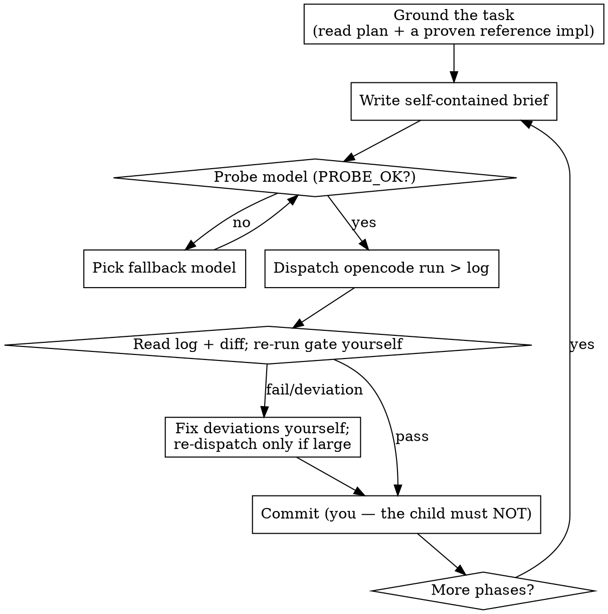

# Orchestrating With `opencode run`

## Overview

Keep your own context small and your quality high by never doing the bulk of the work
yourself. For each task you **write a brief**, **dispatch a fresh `opencode run`**
against another model, then **independently verify** the result and **commit it
yourself**.

**Core principle:** the child does the work and proves it; *you* own the decision.
A child's self-report is a hypothesis, not evidence. "Done" means **you** re-ran the
gate and it passed.

## When to Use

- Multi-phase work (5+ phases), each phase = implement → gate → review → commit.
- Work that must be delegated to other models (cheap/free) to save your context or cost.
- Work spanning multiple repos, or a **shared golden oracle / DB / port / build dir**
  that makes naive parallelism unsafe.
- Free models that rate-limit and die mid-task.

**Don't use when:** it's one small self-contained task you can just do inline.

## The Loop



## 1. Write the Brief (the key artifact)

The child starts with **zero** of your context, so the brief must be fully
self-contained. Write it to a file: `/tmp/opencode/<name>-brief.md`.
Use the [brief template](brief-template.md). It MUST contain:

- **Read first** — the plan doc *and a proven reference implementation to mirror*
  (`mirror farmer-rs/src/event/consumers.rs`). This is the single highest-leverage line.
- **Context** — facts *you verified*, with `file:line`.
- **Change** — numbered, concrete files/functions.
- **Tests** — exact new test names.
- **Gate** — exact commands + expected pass counts.
- **HARD RULES** — scope fence + the guardrails below.
- **Report** — exactly what to report back.

## 2. Probe, Then Dispatch

Free models rate-limit constantly. **Probe before every dispatch** so a limit can't
silently waste a run:

```bash
timeout 180 opencode run --model <provider>/<model> "Reply with exactly: PROBE_OK" \
  > /tmp/opencode/<name>-probe.log 2>&1
grep -q PROBE_OK /tmp/opencode/<name>-probe.log || { echo "model down — switch"; exit 1; }
```

```bash
cd /path/to/repo && opencode run --model <provider>/<model> --auto \
  --file /tmp/opencode/<name>-brief.md \
  "<one-line instruction: implement, run the gate, do NOT commit>" \
  > /tmp/opencode/<name>.log 2>&1; echo "EXIT=$?" >> /tmp/opencode/<name>.log
```

`--auto` = no approval prompts. Always redirect to a log and append `EXIT=$?` — a dead
run still leaves partial evidence you can read.

To run it in the **background** while you prep the next brief, wrap the child + its
exit capture in a subshell, or you'll record the *backgrounding* status, not the run's:

```bash
( cd /path/to/repo && opencode run --model <m> --auto \
    --file /tmp/opencode/<name>-brief.md "implement…; do NOT commit" \
    > /tmp/opencode/<name>.log 2>&1; echo "EXIT=$?" >> /tmp/opencode/<name>.log ) &
```

## 3. Message Passing — How You and the Child Talk

There is **no live channel**. `opencode run` is fire-and-forget: every message travels
through **files, logs, and exit codes**, and both sides start with zero shared memory.
Design the contract in the brief instead of improvising it.

**Down (you → child) — the input**
- **Primary:** the `--file <brief>` itself — the whole task, self-contained.
- **Resume/continuation:** re-dispatch the *same* brief **plus attached state**. Never
  restart from scratch — the working tree already holds the partial change:
  ```bash
  git -C "$REPO" diff > /tmp/opencode/ctx.diff
  opencode run --model "$M" --auto --file /tmp/opencode/<name>-brief.md \
    --file /tmp/opencode/ctx.diff \
    "Resume <name>. It is partially done — see the attached diff. Finish ONLY the
     remaining work, run the gate, do NOT commit." >/tmp/opencode/<name>.log 2>&1
  ```
- **Mid-flight steering is impossible.** To change direction, kill the run (`pkill`
  scoped to *your* process/port) and dispatch a fresh brief.
- **Fan-out:** send the same brief to several models at once (different output files)
  to compare.

**Up (child → you) — the output, in order of reliability**
1. **Files the child writes** — most reliable, and it survives a mid-run rate-limit.
   Review docs, outbox/result files, the diff itself. **Parse files, not stdout.**
2. **The `## Report` section** you *demanded* in the brief (exact fields — see the
   [brief template](brief-template.md)): status, files, evidence, gate numbers,
   `git status --short`.
3. **The run log** — `> /tmp/opencode/<name>.log 2>&1; echo EXIT=$?`.
4. **The child's own opencode session** — when its report is missing or murky, read
   the session straight from the DB:
   ```bash
   sqlite3 ~/.local/share/opencode/opencode.db \
     "SELECT json_extract(data,'\$.text') FROM session_message
      WHERE session_id='<ses_…>' AND type IN ('assistant','user') ORDER BY seq;"
   # newer schema = session_message; older = message + part
   ```

**Completion / heartbeat:** dispatch long runs in the **background**, then poll — don't
block:
```bash
tail -n 20 /tmp/opencode/<name>.log
pgrep -af "opencode run.*<name>" || echo "finished"
```
A `PROBE_OK` probe doubles as a liveness + rate-limit check before (re)dispatch.

**Envelope rule:** every message, down or up, must be **self-contained**. The child has
no memory of your conversation; you have no memory of its reasoning unless it wrote it
down. If it isn't in the brief, the diff, a file, or the log — it didn't happen.

**Prefer a real channel when you have one.** This repo ships `chan` (`chan/`): a durable,
typed channel with direct + pub/sub addressing over a file log, a live `opencode` attach,
and an MCP server. Instead of files/logs-by-hand, use `chan send` / `chan await` / `chan
pump` for the down/up traffic, and give each child **direct attach** by pointing its MCP
config at `chan-mcp --as <participant>` (native `chan_send` / `chan_await` tools, no CLI
shelling). Durable-first means a rate-limited child never loses a message.

## 4. Verify — Never Trust the Child

- **Re-run the gate yourself.** The child's "all green" is a claim.
- **Read the diff**, not just the report. Look for the failure modes below.
- **Residue check:** derived rows/keys/cache left by tests must be `0`.
- **Flake check:** flaky suites hide behind `--test-threads=1` or serial runs. Demand
  **repeated parallel runs** (e.g. ×5, default parallelism) with zero failures.
- Fix small deviations yourself — usually faster and safer than another spin-up.

## 5. Parallelize Safely

Parallelize **by blast radius, not by phase number**:

- **Safe in parallel:** edits to different repos / different files.
- **Serialize (mutual exclusion):** the golden oracle, the shared DB, the gate's
  server **port**, and any crate a concurrent run is rebuilding.
- Use a **`flock`-serialized gate wrapper** ([gate-lock.sh](gate-lock.sh)) that builds,
  runs the server on its **own port**, holds the oracle, and reports
  `rust_rc=… python_rc=…`. Give each parallel run a distinct port.
- Compute the **dependency DAG** first — it usually caps parallelism below what the
  repos allow.
- A shared working tree with a serialized gate is simpler; use `git worktree` per
  parallel phase only if you want isolated trees (the gate still needs the one lock).

## 6. Guardrails That Go in Every Brief

```
- Do NOT commit. The orchestrator reviews and commits.
- Never run git checkout/stash/clean/reset/restore.
- Do NOT touch <tooling/build files the orchestrator owns>.
- Do NOT touch ports/servers you don't own (:27405/:27406).
- Another run may be active: SOURCE ONLY — do not run the gate/DB/build.
- Add no new dependencies unless explicitly allowed.
```

## Model Routing

| Role | Pick |
|------|------|
| Orchestrator | a fast/cheap model — your context stays small |
| Change-maker | a capable "implement" model (`…/cat-jam-free`) |
| Reviewer | a *different* model, read-only, writes a review doc |

Run 2–3 models on the same review → **compare** their claims; the shared claims are
trustworthy, the split points are your decisions. On rate-limit, switch provider/model
(probe first) — don't lose the queue.

## Common Mistakes

| Mistake | Fix |
|---------|-----|
| Letting the child commit | Child implements only; **you** commit |
| `git clean -fdx`/"reset" cleanup between phases | Forbid it; use targeted edits |
| Trusting "done, all tests pass" | Re-run the gate yourself |
| Two oracle runs at once | `flock`-serialize; distinct ports |
| Parsing stdout only | Use a log file + `EXIT=$?` |
| Broad `pkill -f opencode run` | Kill only your own run/port |
| No reference impl in the brief | Point at a sibling implementation to mirror |
| One-off success declared green | Repeat parallel runs; check residue = 0 |
| Expecting a live back-and-forth with the child | No channel — brief goes down, files/log go up |
| Parsing only the child's stdout | Have it **write** a result/report file; read that + the log |
| Restarting a failed run from scratch | Attach `git diff` and re-dispatch a **RESUME** brief |

## Red Flags — STOP

- You're about to say "the run reported success" without running the gate → verify now.
- Your cleanup contains `reset --hard`, `clean -fdx`, `checkout .`, or `stash` → forbidden.
- You dispatched without probing a free model → probe first.
- You're about to launch a second oracle/DB job in parallel → serialize with a lock.
- The child changed files outside its brief's scope, or added a dependency → reject/fix.

## Quick Reference

```bash
# probe → dispatch → verify → commit
timeout 180 opencode run --model $M "Reply with exactly: PROBE_OK" >/tmp/opencode/p.log 2>&1
grep -q PROBE_OK /tmp/opencode/p.log || echo switch-model
cd $REPO && opencode run --model $M --auto --file /tmp/opencode/$N-brief.md \
  "Implement $N from the brief. Run the gate. Do NOT commit." \
  >/tmp/opencode/$N.log 2>&1; echo "EXIT=$?" >>/tmp/opencode/$N.log
# → read log + diff, re-run the gate, then:
git -C $REPO add -A && git -C $REPO commit -m "$N: <goal>"
```
